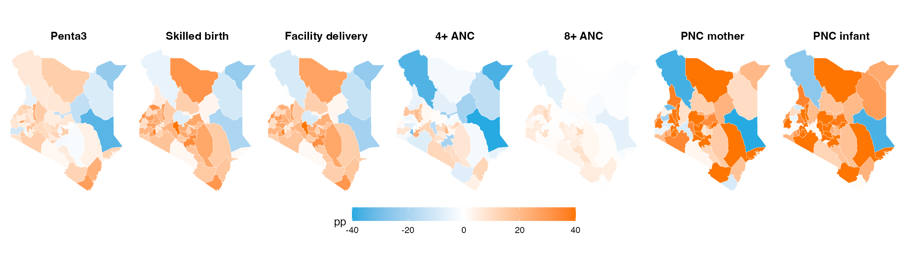
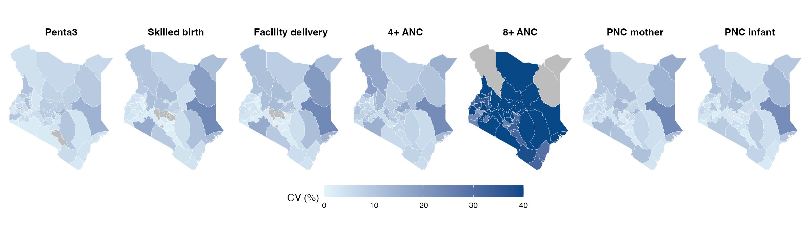

```{r setup, include=FALSE}
knitr::opts_chunk$set(echo = FALSE, warning = FALSE, message = FALSE)
library(knitr)
# Run slides_maps_cv.R first: it writes outputs/slides/*.csv and the two map PNGs.
setwd("~/Library/Mobile Documents/com~apple~CloudDocs/Burden-of-disease-estimation_cema/khis-vs-mkdhs-comparison")
nat <- read.csv("outputs/slides/national_ci_cv.csv", check.names = FALSE)
cvc <- read.csv("outputs/slides/county_cv_summary.csv")
cvc <- cvc[!grepl("sensitivity|live birth", cvc$Indicator), ]

res <- data.frame(
  Indicator = nat$Indicator,
  `KDHS % (95% CI)` = paste0(nat$KDHS, " (", nat$KDHS_CI, ")"),
  `CV %` = nat$CV_pct,
  `KHIS %` = nat$KHIS,
  `Gap pp (95% CI)` = paste0(nat$Gap, " (", nat$Gap_CI, ")"),
  Agreement = ifelse(abs(nat$Gap) < 5, "Minimal", ifelse(abs(nat$Gap) < 10, "Moderate", "Large")),
  check.names = FALSE
)
```

## Introduction

- KHIS is the routine source for planning and burden-of-disease estimation, but its coverage figures depend on reporting completeness and the denominator chosen.
- The Kenya Mini KDHS 2025–26 gives an independent benchmark, with national and 47-county estimates and 95% confidence intervals.
- KHIS aggregate reports (MOH 710 immunisation, MOH 711 maternal) were recomputed for the survey period.
- Indicators: Penta3, skilled birth attendance, facility delivery, 4+ and 8+ ANC, and PNC within 48 hours for mother and infant.

## Research questions

1. How closely do KHIS coverage estimates match the Mini KDHS at national level?
2. Is the agreement consistent across the 47 counties?
3. Does the choice of denominator change the conclusions?

## Objectives

1. Compare national KHIS and Mini KDHS coverage for seven maternal and child indicators, with the gap in percentage points and its 95% CI.
2. Measure county agreement and the precision (coefficient of variation) of the survey estimates.
3. Test Penta3 against three denominators: under-1 population, estimated live births and MOH 711 births.

## Results: national gaps with 95% CI and CV

```{r results-table}
kable(res, row.names = FALSE, align = "lrrrrl")
```

<div style="font-size:18px">
CV = SE ÷ estimate (SE from the report’s 95% CI). Gap = KDHS minus KHIS; KHIS treated as a fixed count.
Bands: minimal < 5 pp, moderate 5 to < 10 pp, large 10+ pp.
</div>

- Survey estimates are precise nationally (CV 0.7–1.3%) except 8+ ANC (8.9%).
- Every gap’s 95% CI excludes zero; large gaps for delivery and PNC (17.5–23.0 pp).

## County maps: KDHS minus KHIS

```{r map-diff, out.width="100%"}

```

Orange = KHIS below the survey; blue = KHIS above. Counties where KHIS exceeds the survey (of 47): Penta3 11, skilled birth 5, facility delivery 7, 4+ ANC 24, 8+ ANC 11, PNC mother 9, PNC infant 5.

## County precision: coefficient of variation

```{r map-cv, out.width="100%"}

```

```{r cv-table}
kable(cvc[, c("Indicator", "median_CV", "pct_CV_over_30")],
      col.names = c("Indicator", "Median county CV %", "% counties CV > 30%"), row.names = FALSE)
```

## Next steps: closing the gaps

1. **Fix denominators:** county-specific facility-birth shares instead of the national 91.1%; reconcile live-birth counts.
2. **Fill data gaps:** MOH 710 reporting rates for Penta3; counts of women with 8 ANC contacts.
3. **Explain the gaps:** test reporting completeness, PNC recording and survey recall (not yet tested).
4. **Stabilise 8+ ANC:** median county CV is 41%; pool counties or use small-area models.
5. **Apply in BoD:** use KHIS directly where agreement is close; calibrate to the survey elsewhere.
6. **Refresh:** rerun when the final KDHS tables and missing KHIS months are available.
